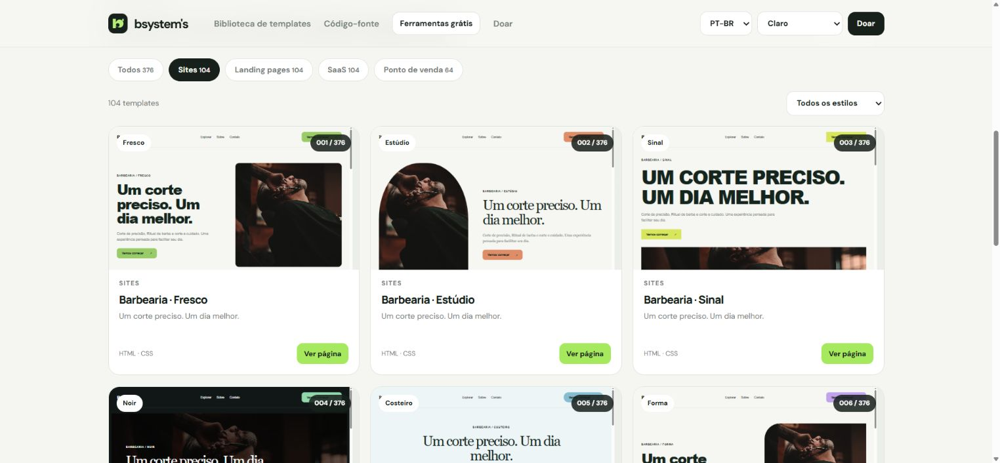

<div align="center">


# bsystem's · source-coppy

**Choose a starting point. Make it yours. Publish it for free.**

[](#catalog)
[](LICENSE)
[](https://brunnojob.github.io/source-coppy/)
[](https://github.com/brunnojob/source-coppy/actions/workflows/pages.yml)

[**Open the free studio →**](https://brunnojob.github.io/source-coppy/) · [Donate](https://donate.stripe.com/6oU8wQg9k9Hb8809CrfQI01) · [Request a template](https://github.com/brunnojob/source-coppy/issues/new)

</div>

[](https://brunnojob.github.io/source-coppy/)

## Build without starting from a blank page

An open-source visual website studio inspired by the freedom of tools like WordPress, delivered as a lightweight static application. Browse **376 ready-to-use templates**, inspect the actual page in a live preview, customize its content, and download standalone HTML. No subscription, account, API key, framework installation, or paid hosting is required.

**This is a static site builder, not a full WordPress CMS replacement.** GitHub Pages serves the studio and your exported sites. Server-side accounts, multi-user databases, payment processing, email delivery, and fiscal invoicing require your own integrations.

## Catalog

| Direction | Templates | Included use cases |
|---|---:|---|
| Websites | 104 | Barbershop, café, dental clinic, gym, bakery, law office, hotel, veterinary clinic, salon, architecture, tattoo studio, florist, photography |
| Landing pages | 104 | Course, product, retreat, event, app waitlist, podcast, fundraising, creative agency, wedding, property, newsletter, fitness, music |
| SaaS starters | 104 | CRM, analytics, invoicing, help desk, scheduling, people operations, inventory, projects, email campaigns, retail, learning, clinic, writing |
| Point of sale | 64 | Barbershop, café, fashion, bakery, pet shop, salon, florist, bookstore |
| **Total** | **376** | **47 use cases × 8 visual directions** |

These are reusable combinations of niche-specific content and **eight different layout systems**, not 376 independently hand-coded applications. Fresh uses a split hero; Studio an editorial portrait; Signal a poster and ticker; Noir a cinematic image; Coastal a centered composition; Form a mosaic; Terra an organic portrait; Mono a typographic index. Layouts also change section order, typography, spacing, borders, and colors. Every combination has a unique ID and complete preview in both supported languages.

## What you can do

- **See the actual page:** catalog thumbnails render the template HTML instead of showing an unrelated stock photo.
- **Customize without coding:** change brand, headline, description, accent color, contact email, and button text. Hide the plans section when it does not fit.
- **Check responsive layouts:** desktop, tablet, and mobile preview sizes.
- **Keep your work:** save separate browser-local drafts by template and language; copy or download the exact customized HTML shown in the preview.
- **Share a starting point:** preview URLs include the template ID, for example [barbershop Fresh](https://brunnojob.github.io/source-coppy/#template=websites-001). Private draft content is not included in that link.
- **Use English or Brazilian Portuguese:** studio controls and generated pages follow the selected language.
- **Choose your environment:** Light by default, Dim, or Dark. Theme and language preferences persist locally.
- **Use free utilities:** text/word counter, color contrast checker, and URL slug generator.

### Interactive starters

**POS exports** include a niche-specific example product catalog, quantity controls, removable cart items, total calculation, sale recording, and a plain-text receipt. Exported pages store sales in that browser when storage is available. These are local starters; there is no payment processor, fiscal receipt, stock synchronization, or production accounting system.

**SaaS exports** include a working local task board with add, complete, remove, and progress counters. The page content is specific to the selected product niche; the board is a shared starter interaction, not a finished CRM, clinic system, AI service, or invoicing backend. Charts are explicitly labeled as example activity.

Previews run in sandboxed frames without same-origin access. Local storage can be unavailable inside the preview; export the HTML to persist board data and POS records on your own origin. The studio itself saves only drafts and preferences to browser storage. Browser storage is not a backup or suitable for confidential business records.

## Start locally

```bash
git clone https://github.com/brunnojob/source-coppy.git
cd source-coppy
python -m http.server 8000
```

Open `http://localhost:8000`. There is no build step. For catalog validation with Node.js 22 or later:

```bash
node --test tests/catalog.test.cjs
```

Tests generate all **752 language variants**, check IDs, document completeness, distinct layouts and section orders, generated-script syntax, escaping, export options, and interactive module inclusion.

## Publish with GitHub Pages

The repository includes `.github/workflows/pages.yml`. It validates the catalog, uploads only public studio files, and deploys on pushes to `main`. Configure **Settings → Pages → Source → GitHub Actions** once. Pull requests run validation without publishing.

To publish an exported page:

1. Download your customized HTML.
2. Rename it to `index.html` and upload it to a repository you own.
3. In that repository, select **Settings → Pages → Deploy from a branch → main → /(root)**.
4. Open the Pages URL shown by GitHub.

The generated page includes its CSS and any local starter JavaScript. Photography is loaded from Unsplash and requires an internet connection; fonts in exported pages use system fallbacks. The studio uses Google Fonts. Review external asset terms and replace photos or example copy as appropriate for your project.

## Donate

**Contribua com qualquer valor e tenha acesso a mais ferramentas.**

**Contribute any amount and get access to more tools.**

[Support bsystem's through Stripe →](https://donate.stripe.com/6oU8wQg9k9Hb8809CrfQI01)

The donation panel includes the requested Stripe embed and a direct secure checkout link. Stripe or browser policies may prevent checkout from displaying inside an iframe; the direct link remains available. All current templates and utilities remain free and open source. Donations support development; the static studio does not verify purchases or unlock paid accounts.

## Contribute

Open an issue with a use case, accessibility concern, translation fix, or layout idea. Catalog data lives in `js/catalog.js`, the rendering engine in `js/templates.js`, and editor behavior in `js/studio.js`. Add bilingual content, keep generated pages responsive, and run the catalog tests before submitting a pull request.

## License

[MIT](LICENSE). External photos and fonts retain their respective terms.
