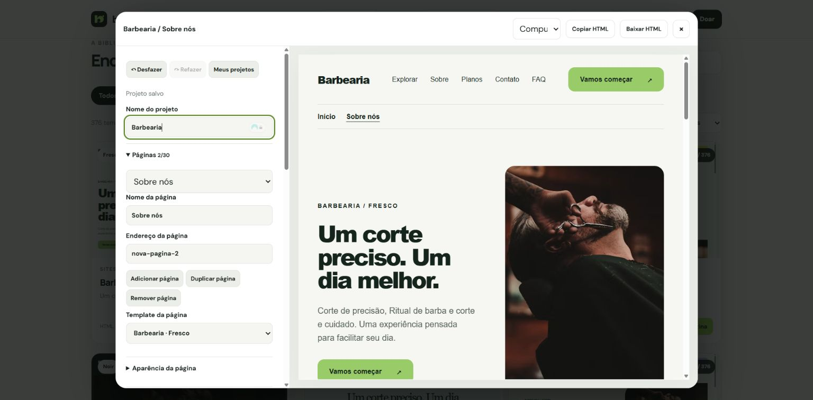

<div align="center">


# bsystem's · source-coppy

**Design your website. Connect your business. Own your data.**

[](#catalog)
[](LICENSE)
[](https://brunnojob.github.io/source-coppy/)
[](https://github.com/brunnojob/source-coppy/actions/workflows/pages.yml)

[**Open the website studio →**](https://brunnojob.github.io/source-coppy/) · [**Business management →**](https://brunnojob.github.io/source-coppy/operations.html) · [Self-hosting guide](docs/SELF_HOSTING.md) · [Donate](https://donate.stripe.com/6oU8wQg9k9Hb8809CrfQI01)

</div>

[](https://brunnojob.github.io/source-coppy/)

## A free studio with room to grow

An open-source visual website editor with **376 templates**, editable multi-page projects, portable exports, and a self-hosted business API. The editor runs on GitHub Pages without a backend. Connect your own server when you need team accounts, shared records, checkout operations, inventory and cash-register reconciliation.

No subscription, API key or cloud account is required for the website editor. The business API runs on your own Python/Docker server; hosting, TLS, backups and any external payment integrations remain your responsibility. **No business backend is provisioned automatically.**

## Website editor

- **Actual previews:** catalog cards render template HTML. Desktop, tablet and mobile previews use the same page engine as exports.
- **Multi-page sites:** add, duplicate, rename and remove pages; choose a different template for each page; edit filenames; navigate between pages inside the preview.
- **Image editing:** replace cover photos with HTTPS URLs or upload PNG/JPEG/WebP files up to 5 MB. Uploaded images are resized to a maximum dimension of 1600 pixels, encoded as WebP and embedded into exported pages. Edit alt text and vertical crop position.
- **Block organization:** drag blocks or use keyboard-accessible up/down buttons. Add text, gallery, call-to-action and built-in sections; edit block headings/text; hide, duplicate or remove blocks. The functional business block cannot be duplicated because it owns interactive element IDs.
- **Appearance:** brand, headline, description, accent color, contact email, button copy, typography and SEO title.
- **Project storage:** auto-save on this device using IndexedDB; open saved projects from My projects. Download/import project JSON for a portable editable backup.
- **Team project storage:** explicitly save/load private project documents through your server after signing in on the Business page. Version checks prevent overwriting a newer server copy.
- **Exports:** copy/download the current HTML, or download a ZIP containing every page, working navigation and the business-management frontend. Editable project JSON is exported separately, so hidden block text is not accidentally published.
- **PT-BR / EN:** controls and template defaults follow the selected language. Your custom text stays exactly as written; it is not automatically translated.
- **Light / Dim / Dark:** studio themes and language preferences persist locally.

Projects support up to 30 pages, 40 blocks per page and 12 images per gallery. Imported project files are limited to 20 MB and validated against the catalog. JSON is editable project data, not arbitrary executable HTML. New text/gallery blocks accept plain text and safe image URLs.

## Catalog

| Direction | Templates | Use cases |
|---|---:|---|
| Websites | 104 | Barbershop, café, dental clinic, gym, bakery, law office, hotel, veterinarian, salon, architecture, tattoo studio, florist, photography |
| Landing pages | 104 | Course, product, retreat, event, app waitlist, podcast, fundraising, creative agency, wedding, property, newsletter, fitness, music |
| SaaS starters | 104 | CRM, analytics, invoicing, help desk, scheduling, people operations, inventory, projects, campaigns, retail, learning, clinic, writing |
| Point of sale | 64 | Barbershop, café, fashion, bakery, pet shop, salon, florist, bookstore |
| **Total** | **376** | **47 use cases × 8 layout systems** |

The catalog combines niche-specific content with **Fresh, Studio, Signal, Noir, Coastal, Form, Terra and Mono**. Layouts differ in hero composition, section order, typography, shapes and colors. These are 376 editable combinations, not 376 independently developed business systems.

## Business operations on your server

The separate **Business** application connects to a Python/FastAPI API with a persistent SQLite database. It includes:

| Area | Implemented behavior |
|---|---|
| Accounts | Owner, manager, cashier and member permissions; hashed passwords; expiring sessions; logout and revocation |
| Team | Single-use invitations; activation/deactivation; owner protection |
| CRM | Customers, contact details, notes and archival |
| Work | Shared tasks, assignments, due dates and workflow stages |
| Inventory | Products, SKU, integer-cent prices, tracked/untracked items, adjustments and stock ledger |
| Sales | Server-controlled totals, discounts restricted to managers, atomic stock reduction and idempotent retry |
| Returns | Full return once per sale, tracked-stock restoration and refund ledger |
| Cash | Per-operator opening/closing, counted/expected cash and discrepancy |
| Reports | Daily UTC sales, return totals, net recorded sales, low stock, recent history, CSV export and audit |
| Projects | Private business-scoped website projects with optimistic version checks |
| Recovery | Consistent SQLite backups and local password recovery commands |

The template previews keep their small local demonstration modules; use **Open server-connected management** in SaaS/POS exports for the authenticated business frontend. Uploaded/generated pages do not contain server credentials.

Card/Pix selections **record an externally received payment**. They do not charge a card, confirm Pix settlement, or issue monetary refunds. Receipts have no fiscal value. NF-e/NFC-e, accounting/tax integrations, payment-provider APIs, medical records, payroll, campaign delivery and AI model services are not included. The shared business application implements common operations rather than every domain-specific feature suggested by the SaaS marketing templates.

For installation, roles, first-owner creation, HTTPS, backups, recovery and deployment limits, read **[Self-hosting](docs/SELF_HOSTING.md)**.

## Start locally

```bash
git clone https://github.com/brunnojob/source-coppy.git
cd source-coppy
python -m http.server 8000
```

Open `http://localhost:8000`. The website editor has no build step and no runtime npm dependencies.

For the business API (Python 3.12):

```bash
pip install -r server/requirements.txt
python -m server.manage bootstrap --business "Your business" --email "you@example.com" --name "Owner"
uvicorn server.app:app --host 127.0.0.1 --port 9000
```

Open `http://localhost:8000/operations.html`, set `http://localhost:9000` as the server URL, and sign in. The bootstrap command prompts privately for the owner's password. Docker Compose is also included.

## Validate

```bash
npm ci
npm test
pip install -r server/requirements-test.txt
python -m unittest discover -s tests -p 'test_*.py' -v
```

Frontend tests cover all 752 template/language combinations, project import validation, page links, reordering, gallery/image settings, save/restore, undo/redo, interoperable ZIP export, integer money parsing, CSV safety, role-specific UI and retrying the exact same pending sale. Backend tests use disposable databases to verify isolation, permissions, sessions, invitations, concurrent sales, idempotency, returns, reconciliation, optimistic edits and backup recovery.

## Publish a website

1. Open a template and customize its pages, images and blocks.
2. Download **site ZIP** and extract it.
3. Upload its files to your repository, keeping the folders and `index.html` at the root.
4. Enable **Settings → Pages → Deploy from a branch → main → /(root)**.

Uploaded images are embedded into HTML; remote image URLs still require network access. The main studio loads Google Fonts and original photography from external providers. Check external asset terms before commercial use.

This repository's `.github/workflows/pages.yml` runs frontend/backend tests and deploys only public HTML, JS, CSS and branding files on pushes to `main`. It never uploads the API, database or server configuration to Pages. Pull requests validate without deployment.

## Donate

**Contribua com qualquer valor e tenha acesso a mais ferramentas.**

[Contribute any amount through Stripe →](https://donate.stripe.com/6oU8wQg9k9Hb8809CrfQI01)

All templates and current utilities remain free and MIT-licensed. Donations support ongoing development. The panel's direct Stripe link is the reliable payment route. Stripe blocks a hosted Payment Link checkout inside a generic iframe; an official Stripe Buy Button embed requires the button code generated for that link, and is not the same as an embedded full payment form. This static project does not verify donation payments or unlock paid accounts.

## Project structure

| Path | Purpose |
|---|---|
| `index.html`, `css/editor.css` | Catalog and editor shell |
| `js/catalog.js`, `js/templates.js` | Catalog data and page renderer |
| `js/project.js`, `js/editor.js` | Project document, validation, ZIP, editor and local persistence |
| `operations.html`, `js/business.js` | Business-management frontend |
| `js/api.js` | Server connection and exact money/CSV helpers |
| `server/` | Authenticated API, schema and local operator commands |
| `tests/` | Frontend and backend verification |

## Contribute

Open an issue with a use case, layout, translation, accessibility concern or workflow improvement. Keep content bilingual, preserve export compatibility, and run the tests before submitting a pull request.

## License

[MIT](LICENSE). External assets retain their respective licenses.
